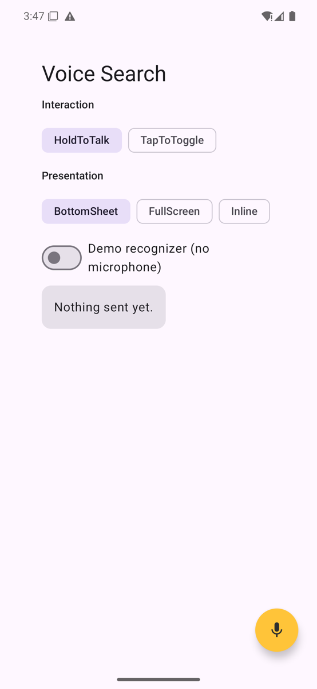
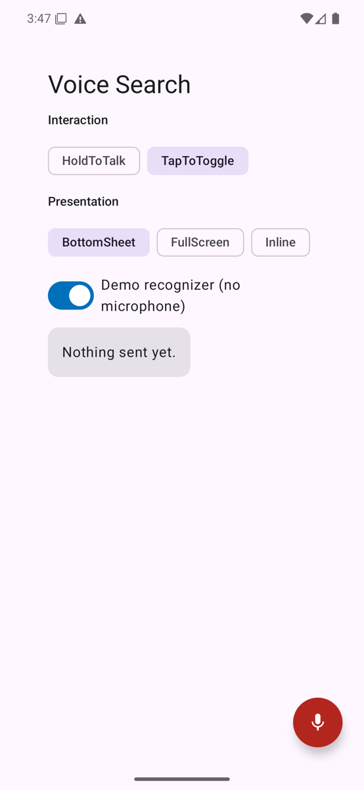
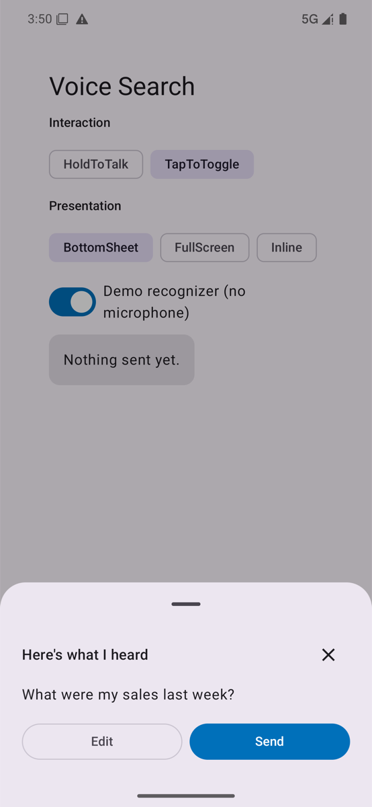
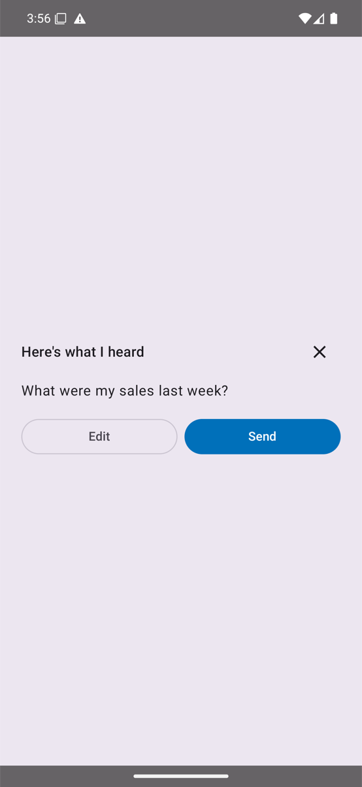
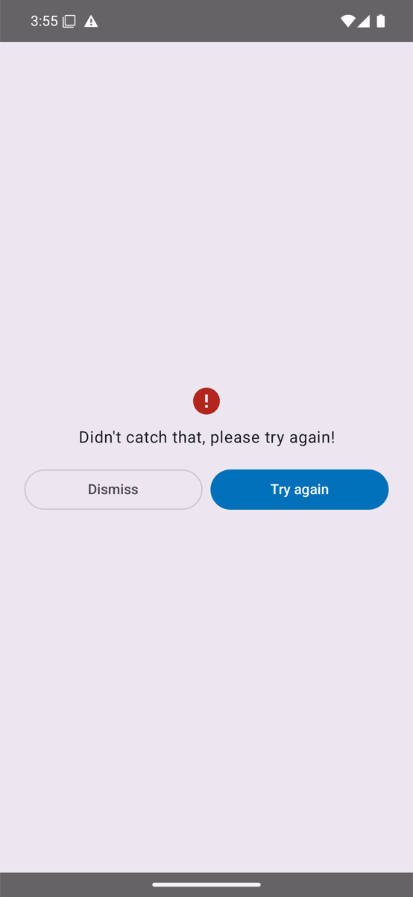
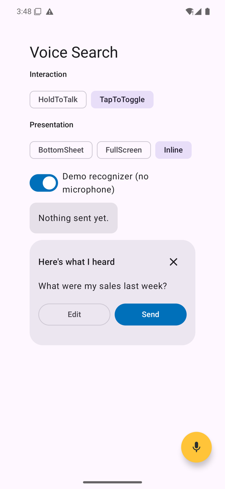

# Voice-Search

A Compose Multiplatform (Android + iOS) SDK, built on Material 3, for hold-to-talk voice search.
Press and hold the mic button, speak, then review, optionally edit, and send the transcript.
Android uses `SpeechRecognizer`; iOS uses `SFSpeechRecognizer` + `AVAudioEngine`. Strings, colors,
language and flow are all configurable.

## Demo

The sample app lets you switch interaction mode and presentation live.

| Home | Bottom sheet: listening | Bottom sheet: review |
| --- | --- | --- |
|  |  |  |

| Full screen: review | Full screen: error | Inline: review |
| --- | --- | --- |
|  |  |  |

## Install

Via [JitPack](https://jitpack.io/#krajarajan96/Voice-Search):

```kotlin
// settings.gradle.kts
dependencyResolutionManagement {
    repositories { maven(url = "https://jitpack.io") }
}

// your module's build.gradle.kts
dependencies {
    implementation("com.github.krajarajan96:Voice-Search:v0.1.0")
}
```

Like any KMP library, this resolves for iOS when your iOS app is itself a Kotlin Multiplatform
Gradle project (see the `sample` module).

### Platform setup

- **Android:** `RECORD_AUDIO` and the `RecognitionService` `<queries>` entry are merged in from
  the library manifest. The permission prompt is shown on first use.
- **iOS:** add both keys to your `Info.plist`:
  `NSMicrophoneUsageDescription` and `NSSpeechRecognitionUsageDescription`.

## Usage

```kotlin
val controller = rememberVoiceCaptureController { transcript ->
    // The user reviewed and sent this text.
}

VoiceFab(
    isListening = controller.isListening,
    onPressStart = controller::onFabPressStart,
    onPressEnd = controller::onFabPressEnd,
)
VoiceCaptureSheet(controller)
```

The FAB is optional: call `controller.onFabPressStart()` / `onStopListening()` (or `onFabTap()` to
toggle) from any UI, such as a mic icon in a search bar. Call `controller.onAppBackgrounded()` when
your app pauses.

### Interaction modes

`VoiceInteractionMode.HoldToTalk` (default) records while the button is held. `TapToToggle` starts
on one tap and stops on the next. Both are handled by `VoiceFab` and `controller.onFabTap()`.

### Presentation

`VoiceCaptureSheet(controller, config)` shows the capture UI in the container set by
`config.presentation`:

- `BottomSheet` (default): modal bottom sheet.
- `FullScreen`: full-screen dialog.
- `Inline`: rendered where you call it, inside your own layout.

For full control, place `VoiceCaptureContent(controller, config)` anywhere in your UI. It is the
bare listening/review/edit/error content with no container.

## Config options

Pass a `VoiceSearchConfig` to `rememberVoiceCaptureController`, `VoiceFab` and `VoiceCaptureSheet`:

```kotlin
val config = VoiceSearchConfig(
    languageTag = "en-GB",
    allowEdit = false,
    interactionMode = VoiceInteractionMode.TapToToggle,
    presentation = VoicePresentation.FullScreen,
    strings = VoiceSearchStrings.defaults().copy(send = "Search"),
    colors = VoiceSearchColors(fabIdleContainer = Color(0xFFFFC439)),
)
```

| Field | Default | Purpose |
| --- | --- | --- |
| `strings` | `VoiceSearchStrings.defaults()` | All copy, button labels, accessibility text and error messages. |
| `colors` | `VoiceSearchColors.defaults()` | FAB idle/listening colors, sheet container, accent. Unspecified falls back to the Material theme. |
| `languageTag` | `null` | BCP-47 language (e.g. `en-US`); `null` uses the device locale. |
| `partialResults` | `true` | Stream interim transcripts while the user speaks. |
| `preferOffline` | `false` | Prefer on-device recognition when a model is available. |
| `allowEdit` | `true` | Show the "Edit" step before sending. |
| `autoSend` | `false` | Skip review and deliver a non-blank transcript immediately. |
| `interactionMode` | `HoldToTalk` | `HoldToTalk` or `TapToToggle` for `VoiceFab`. |
| `presentation` | `BottomSheet` | `BottomSheet`, `FullScreen` or `Inline`. |

To use another engine, implement `VoiceRecognizer` and pass it to `VoiceCaptureController`.

## Modules

- `voicesearch`: the library (`com.voicesearch:voicesearch`).
- `sample`: a minimal Android + iOS app.

## Building

```
./gradlew :voicesearch:testDebugUnitTest
./gradlew :sample:assembleDebug
```

The iOS sample lives in `iosApp/` (open `iosApp/iosApp.xcodeproj` in Xcode).

## License

MIT, see [LICENSE](LICENSE).
